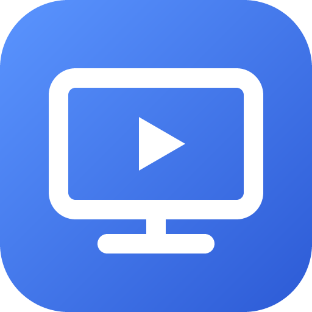

# LocalStreamShare

[Windows版をダウンロード](https://github.com/hungbok/localstreamshare-releases/releases/latest) · [English](README.md) · [한국어](README.ko.md) · [简体中文](README.zh-CN.md) · [繁體中文](README.zh-TW.md)

同じWi‑Fi/LANにあるスマートフォン・PC・テレビへ、**選んだ画面と音だけ**を超低遅延で配信します。見る側はブラウザーでアドレスを開くだけです。開発: **HungBok**

## 主な機能

- **自分のネットワーク内だけで動作します。** 映像はPCから視聴端末へ直接送られます(WebRTC)。アカウント、外部サーバー、時間制限はありません。
- **画面ソース**: モニター、1つのウィンドウ、キャプチャーボード・ウェブカメラ(PC画面を経由せず直接配信)、動画ファイル、スマートフォンや他のPCの画面
- **音声ソース**: 出力デバイス、特定のアプリのみ(または特定のアプリ以外すべて)、マイク、キャプチャーボードの音。複数を個別の音量でミックスできます。
- ゲーム向けの**超低遅延プリセット**: ハードウェアH.264 · 60fps · 1080p、視聴側のバッファを最小化
- **GPUによる画質向上**: 超解像(FSR 1.0 · Anime4K)、アンチエイリアス、ノイズ除去、フレーム生成(モーション補間)、色補正
- **スマートフォンをソースに**: Androidはワイヤレス デバッグで画面・音声・操作(アプリ不要)、どの端末でもブラウザーから、iPhoneはRTMP配信アプリから
- プレビューの全画面表示、性能ダッシュボード(F3)、接続PIN、接続用QRコード
- 韓国語・英語・日本語・中国語(簡体字・繁体字)に対応。視聴ページは開いた端末の言語で表示されます。

## インストール

1. [Releases](https://github.com/hungbok/localstreamshare-releases/releases/latest)から`LocalStreamShare-Setup-x.y.z.exe`をダウンロードして実行します。
2. 言語・インストール先・ショートカットを選びます。すべてのユーザー向けにインストールされ、管理者権限を1回確認します。
3. コード署名がないため、Windows SmartScreenの警告が出ることがあります。このページから入手したファイルであることを確認し、**詳細情報 → 実行**を押してください。
   - **スマート アプリ コントロール**がオンの場合(一部の新しいWindows 11 PC)、署名のないプログラムは選択肢なくブロックされます。状態は**Windows セキュリティ → アプリとブラウザーの制御**で確認できます。
4. 初回起動時にWindowsファイアウォールの確認が表示されます。**プライベートネットワークで許可**しないと他の端末から接続できません。

**Windows 10 バージョン2004以降 / Windows 11、64ビット**が必要です。ほかにインストールするものはありません。

## クイックスタート

1. **画面ソース**で画面を選び、**音声ソース**で配信する音をオンにします。
2. **配信を開始**を押します。
3. 他の端末で**接続アドレス**に表示されたアドレス(例: `http://192.168.0.10:47800`)を開くか、QRコードを読み取ります。

同じネットワークを他の人も使う場合は**接続PIN**を設定してください。

## スマートフォン・他のPCをソースにする

**画面ソース → 外部機器 → 機器を接続**に手順が表示されます。

| 端末 | 方法 | 操作 |
|---|---|---|
| Android 11以降 | ワイヤレス デバッグ(QRペア設定)、画面と音声 | タッチ・キーボード・クリップボード |
| Android 5~10 | USBデバッグのケーブル接続 | 同上 |
| iPhone · iPad | RTMP配信アプリ(例: Larix Screencaster) | Bluetoothマウス・キーボード(実験的) |
| PC · Mac · Chromebook | ウェブページから画面共有 | – |
| スマートフォンのカメラ | ウェブページ | – |

Android接続ファイル(約11MB)は初回のみ[scrcpy](https://github.com/Genymobile/scrcpy)の公式配布物から取得し、改ざんがないか確認します。AirPlayの受信にはライセンスの異なる(GPL‑3.0)別モジュールが必要で、同梱していません。

## オプション: GPUランタイム

NVIDIA Video Effects SDKのランタイムがあれば、NVIDIA RTX Videoの超解像とフレーム生成を使えます。ライセンス上同梱できないため、ファイルを**設定 → 追加コンポーネントフォルダーを開く → `rtx-runtime`** に入れて再起動してください。ない場合は内蔵方式で処理します。

## 更新

起動時と4時間ごとに新しいバージョンを確認し、バックグラウンドでダウンロードします。配信は中断されず、好きなときに再起動するか、終了時にインストールされます。**設定**でオフにできます。

## プライバシー

画面と音は、同じネットワークで接続した端末にのみ送信されます。アプリがインターネットに接続するのは、GitHubでの更新確認と、要求した場合のAndroidファイルのダウンロードだけです。

## 接続できないとき

- 両方の端末が同じルーターに接続されている必要があります。ゲストWi‑Fiは端末同士の通信を遮断することがあります。
- **Windows セキュリティ → ファイアウォールとネットワーク保護 → ファイアウォールによるアプリケーションの許可**で、現在のネットワークの種類(プライベートまたはパブリック)にLocalStreamShareが許可されているか確認してください。
- 遅延を抑えるには5GHz Wi‑Fiまたは有線接続を使用してください。

使用しているオープンソースのライセンスは、アプリの**設定 → オープンソースライセンス**で確認できます。
