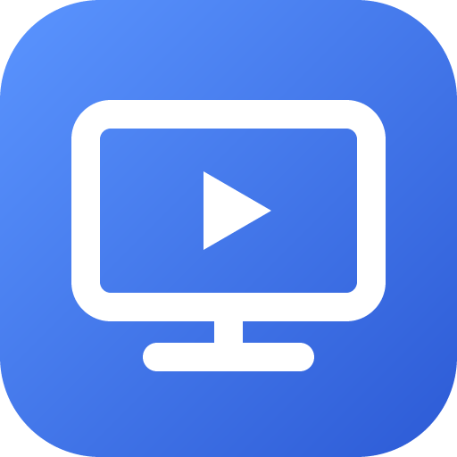

# LocalStreamShare

[Windows용 내려받기](https://github.com/hungbok/localstreamshare-releases/releases/latest) · [English](README.md) · [日本語](README.ja.md) · [简体中文](README.zh-CN.md) · [繁體中文](README.zh-TW.md)

같은 Wi‑Fi/LAN에 있는 휴대폰·PC·TV로 **선택한 화면과 소리만** 초저지연으로 보냅니다. 보는 쪽은 브라우저로 주소만 열면 됩니다. 개발: **HungBok**

## 주요 기능

- **내 네트워크 안에서만 동작합니다.** 영상은 PC에서 보는 기기로 바로 갑니다(WebRTC). 계정도, 외부 서버도, 시간 제한도 없습니다.
- **화면 소스**: 모니터, 창 하나, 캡처보드·웹캠(PC 화면을 거치지 않고 바로 송출), 동영상 파일, 휴대폰이나 다른 PC의 화면
- **오디오 소스**: 출력 장치, 특정 앱만(또는 특정 앱만 빼고 전체), 마이크, 캡처보드 소리. 여러 개를 볼륨을 따로 정해 섞을 수 있습니다.
- 게임용 **초저지연 프리셋**: 하드웨어 H.264 · 60fps · 1080p, 보는 쪽 버퍼 최소화
- **GPU 화질 향상**: 초해상도(NVIDIA DLSS / DLAA · NVIDIA RTX™ Video · AMD FSR™ · Anime4K), 프레임 생성(NVIDIA VFG · DLSS Frame Generation · FSR 3 · 모션 보간), 안티앨리어싱, 노이즈 제거, 색 보정. 필요한 파일이 모두 포함되어 있습니다.
- **휴대폰을 소스로**: Android는 무선 디버깅으로 화면·소리·조작(앱 설치 없음), iPhone·iPad는 AirPlay 화면 미러링으로, 어떤 기기든 브라우저로, RTMP 방송 앱으로
- 미리보기 전체화면, 성능 대시보드(F3), 접속 PIN, 접속용 QR 코드
- 한국어·영어·일본어·중국어 간체·번체 지원. 시청 페이지는 보는 기기의 언어로 표시됩니다.

## 설치

1. [Releases](https://github.com/hungbok/localstreamshare-releases/releases/latest)에서 `LocalStreamShare-Setup-x.y.z.exe`를 내려받아 실행합니다.
2. 언어를 고르고 사용권 계약을 확인한 뒤 설치 위치·바로가기를 고릅니다. 모든 사용자용으로 설치되어 관리자 권한을 한 번 묻습니다.
3. 코드 서명이 없어 Windows SmartScreen 경고가 나올 수 있습니다. 이 페이지에서 받은 파일인지 확인한 뒤 **추가 정보 → 실행**을 누르세요.
   - **스마트 앱 컨트롤**이 켜져 있으면(일부 새 Windows 11 PC) 서명 없는 프로그램은 선택지 없이 차단됩니다. **Windows 보안 → 앱 및 브라우저 컨트롤**에서 상태를 볼 수 있습니다.
4. 처음 실행하면 Windows 방화벽이 허용 여부를 묻습니다. **개인 네트워크에서 허용**해야 다른 기기가 접속할 수 있습니다.

**Windows 10 2004 이상 / Windows 11, 64비트**가 필요합니다. 그 밖에 따로 설치할 것은 없습니다. 디스크 공간은 약 1GB가 필요합니다.

## 빠른 시작

1. **화면 소스**에서 화면을 고르고, **오디오 소스**에서 보낼 소리를 켭니다.
2. **송출 시작**을 누릅니다.
3. 다른 기기에서 **접속 주소**에 나온 주소(예: `http://192.168.0.10:47800`)를 열거나 QR 코드를 찍습니다.

같은 네트워크를 다른 사람도 쓴다면 **접속 PIN**을 설정하세요.

## 휴대폰·다른 PC를 소스로 쓰기

**화면 소스 → 외부 기기 → 기기 연결**에 순서가 나옵니다.

| 기기 | 방법 | 조작 |
|---|---|---|
| Android 11 이상 | 무선 디버깅(QR 페어링), 화면과 소리 | 터치·키보드·클립보드 |
| Android 5~10 | USB 디버깅 케이블 | 위와 같음 |
| iPhone · iPad · Mac | AirPlay 화면 미러링(실험적) 또는 RTMP 방송 앱(예: Larix Screencaster) | 블루투스 마우스·키보드(실험적) |
| PC · Mac · 크롬북 | 웹페이지에서 화면 공유 | – |
| 휴대폰 카메라 | 웹페이지 | – |

안드로이드 연결 파일([scrcpy](https://github.com/Genymobile/scrcpy) 서버와 adb)은 포함되어 있습니다. AirPlay 수신은 [UxPlay](https://github.com/FDH2/UxPlay)의 비공식 구현을 사용하며 Apple이 제공하는 것이 아닙니다. 넷플릭스처럼 보호된 영상은 미러링되지 않습니다.

## GPU 기능

| 기능 | 필요한 것 |
|---|---|
| NVIDIA DLSS / DLAA, RTX Video 초해상도, Video Frame Generation | NVIDIA RTX GPU와 최신 드라이버 |
| NVIDIA DLSS Frame Generation | NVIDIA RTX 40 시리즈 이상 |
| AMD FSR 2 / 3, FSR 3 Frame Generation | 현재는 NVIDIA RTX GPU |
| FSR 1.0, Anime4K, 모션 보간, 안티앨리어싱, 노이즈 제거 | 모든 GPU |

이 PC에서 쓸 수 없는 항목은 사용 불가로 표시됩니다.

## 업데이트

시작할 때와 4시간마다 새 버전을 확인해 뒤에서 내려받습니다. 송출을 끊지 않으며, 원할 때 다시 시작하거나 프로그램을 끌 때 설치됩니다. **설정**에서 끌 수 있습니다.

## 개인정보

화면과 소리는 같은 네트워크에서 접속한 기기로만 보냅니다. 앱이 스스로 인터넷에 연결하는 것은 GitHub 업데이트 확인뿐입니다. NVIDIA 구성요소는 NVIDIA 드라이버를 통해 업데이트될 수 있습니다.

## 접속이 안 될 때

- 두 기기가 같은 공유기에 연결되어 있어야 합니다. 게스트 Wi‑Fi는 기기끼리의 연결을 막는 경우가 많습니다.
- **Windows 보안 → 방화벽 및 네트워크 보호 → 방화벽에서 앱 허용**에서 지금 네트워크 종류(개인 또는 공용)에 LocalStreamShare가 허용되어 있는지 확인하세요.
- 지연을 줄이려면 5GHz Wi‑Fi나 유선을 사용하세요.

## 라이선스

LocalStreamShare는 MIT 라이선스로 무료입니다. 함께 포함된 구성요소는 각자의 라이선스를 따르며, 설치 폴더의 `licenses`에 들어 있습니다(**설정 → 라이선스 폴더 열기**).

| 구성요소 | 라이선스 |
|---|---|
| NVIDIA DLSS, NVIDIA RTX™ Video, NVIDIA Video Effects, CUDA 런타임 | NVIDIA RTX SDKs License, NVIDIA Software License Agreement, NVIDIA Open Model License |
| AMD FidelityFX | AMD 라이선스 / MIT |
| scrcpy 서버, Android Debug Bridge | Apache License 2.0 |
| FairPlay.exe (UxPlay) | GPL‑3.0, 소스 코드는 `licenses\FairPlay\source` |
| Microsoft Visual C++ 런타임 | Microsoft 라이선스 |
| Electron, Anime4K 등 | `THIRD_PARTY_NOTICES.txt` |

NVIDIA 구성요소는 NVIDIA GPU가 있는 PC에서만 쓸 수 있고 따로 재배포할 수 없습니다. NVIDIA, AMD, Microsoft, Apple, Google이 보증하거나 후원하는 프로그램이 아니며, 상표는 각 회사의 것입니다.
