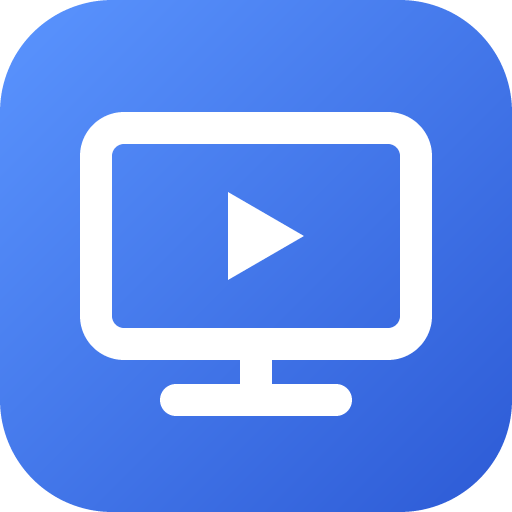

# LocalStreamShare

[Download for Windows](https://github.com/hungbok/localstreamshare-releases/releases/latest) · [한국어](README.ko.md) · [日本語](README.ja.md) · [简体中文](README.zh-CN.md) · [繁體中文](README.zh-TW.md)

Stream **only the screen and sound you choose** to phones, PCs and TVs on the same Wi‑Fi/LAN, with ultra low latency. Viewers just open an address in a browser. Developed by **HungBok**.

## Features

- **Runs on your own network.** Video goes straight from your PC to the viewer (WebRTC). No account, no outside server, no time limit.
- **Screen sources**: a monitor, a single window, a capture card or webcam (sent directly, without passing through the PC screen), a video file, or the screen of a phone or another PC.
- **Audio sources**: an output device, a single app (or everything except one app), microphones and capture card audio. Mix several with separate volumes.
- **Ultra low latency preset** for games: hardware H.264, 60 fps, 1080p, minimal buffering on the viewer side.
- **Picture enhancement on the GPU**: super resolution (NVIDIA DLSS / DLAA, NVIDIA RTX™ Video, AMD FSR™, Intel® XeSS, Anime4K), frame generation (NVIDIA VFG, DLSS Frame Generation, FSR 3, motion interpolation), anti-aliasing, noise reduction and color correction. Everything needed is included.
- **Phones as sources**: Android over Wireless debugging (screen, sound and control, no app to install), iPhone and iPad over AirPlay screen mirroring, any device's browser, and RTMP broadcast apps.
- **It remembers** the window position, the chosen sources and volumes, the address and port. When a chosen window, device or app disappears, it switches back as soon as it returns.
- **Keeps going in the background**: minimized windows can be chosen and streamed, and minimizing a window you are streaming does not stop it.
- **Access from the internet** if you want it (off by default): opens router ports automatically, shows the public IP, port and QR code, and is protected by a PIN.
- Preview in full screen (with a control panel for phones), performance dashboard (F3), access PIN, QR code for viewers.
- Korean, English, Japanese, Simplified and Traditional Chinese. The viewer page follows the language of the device it is opened on.

## Install

1. Download `LocalStreamShare-Setup-x.y.z.exe` from [Releases](https://github.com/hungbok/localstreamshare-releases/releases/latest) and run it.
2. Choose a language, read the license agreement, and choose a folder and shortcuts. It installs for all users and asks for administrator permission once.
3. The installer is not code-signed, so Windows SmartScreen may warn you. Check that you downloaded it from this page, then choose **More info → Run anyway**.
   - If **Smart App Control** is on (some new Windows 11 PCs), Windows blocks every unsigned program and offers no such choice. Check it in **Windows Security → App & browser control**.
4. On first start Windows Firewall asks for permission. **Allow it on private networks**, or viewers cannot connect.

Requires **Windows 10 version 2004 or later / Windows 11, 64-bit**. Nothing else needs to be installed. About 1 GB of disk space is needed.

## Quick start

1. Choose a screen under **Screen source**, and turn on the sounds you want under **Audio sources**.
2. Press **Start streaming**.
3. On the other device, open the address shown under **Address** (for example `http://192.168.0.10:47800`) or scan the QR code.

Set an **Access PIN** if other people use the same network.

### Watching from another network

Turn on **Settings → Allow external (internet) access**. It opens ports on the router (UPnP) and shows the public IP and port to connect to; if the router does not support that, it lists the ports to forward yourself. Outside devices need the **external access PIN** and can only watch. It may not work on connections without a public IP address. Turn it off when you are not using it.

## Phones and other PCs as sources

**Screen source → External → Connect device** shows the steps.

| Device | How | Control |
|---|---|---|
| Android 11 or later | Wireless debugging (QR pairing), screen and sound | Touch, keyboard, clipboard |
| Android 5–10 | USB debugging cable | Same |
| iPhone · iPad · Mac | AirPlay screen mirroring (experimental), or an RTMP broadcast app (e.g. Larix Screencaster) | Bluetooth mouse/keyboard (experimental) |
| PC · Mac · Chromebook | Share the screen from a web page | – |
| Phone camera | Web page | – |

The Android connection files ([scrcpy](https://github.com/Genymobile/scrcpy) server and adb) are included. AirPlay reception uses an unofficial implementation from [UxPlay](https://github.com/FDH2/UxPlay) that is not provided by Apple; protected video such as Netflix is not mirrored.

## GPU features

| Feature | Needs |
|---|---|
| NVIDIA DLSS / DLAA, RTX Video Super Resolution, Video Frame Generation | NVIDIA RTX GPU and a recent driver |
| NVIDIA DLSS Frame Generation | NVIDIA RTX 40 series or newer |
| AMD FSR 2 / 3, FSR 3 Frame Generation, Intel XeSS | any recent GPU (NVIDIA, AMD or Intel, DirectX 12) |
| AMD FSR 4 | AMD Radeon RX 9000 series |
| FSR 1.0, Anime4K, motion interpolation, anti-aliasing, noise reduction | any GPU |

Options that your PC cannot use are shown as unavailable.

## Updates

The app checks for a new version at startup and every four hours, and downloads it in the background. It never interrupts a stream: restart when you like, or it installs when you quit. You can turn this off in **Settings**.

## Privacy

Your screen and sound are sent only to the devices that connect on your network. The only internet connection the app itself makes is the update check on GitHub. Only when you allow external access does it also contact a service that reports the public IP (such as ipify) and accept connections from the internet. What it remembers, such as the chosen sources, is stored only on this PC. NVIDIA may update its own components through its driver.

## If viewers cannot connect

- Both devices must be on the same router. Guest Wi‑Fi often blocks devices from reaching each other.
- In **Windows Security → Firewall & network protection → Allow an app through firewall**, check that LocalStreamShare is allowed for your network type (private or public).
- Use 5 GHz Wi‑Fi or a cable for the lowest latency.

## Licenses

LocalStreamShare is free under the MIT License. The components included with it stay under their own licenses, which are installed in the `licenses` folder (**Settings → Open the licenses folder**):

| Component | License |
|---|---|
| NVIDIA DLSS, NVIDIA RTX™ Video, NVIDIA Video Effects, CUDA runtime | NVIDIA RTX SDKs License, NVIDIA Software License Agreement, NVIDIA Open Model License |
| AMD FidelityFX | AMD license / MIT |
| Intel XeSS | Intel Simplified Software License |
| scrcpy server, Android Debug Bridge | Apache License 2.0 |
| FairPlay.exe (from UxPlay) | GPL‑3.0, with its source code in `licenses\FairPlay\source` |
| Microsoft Visual C++ runtime | Microsoft license |
| Electron, Anime4K and others | see `THIRD_PARTY_NOTICES.txt` |

NVIDIA components work only on systems with NVIDIA GPUs and may not be redistributed separately. LocalStreamShare is not sponsored or endorsed by NVIDIA, AMD, Intel, Microsoft, Apple or Google. All trademarks belong to their owners.
