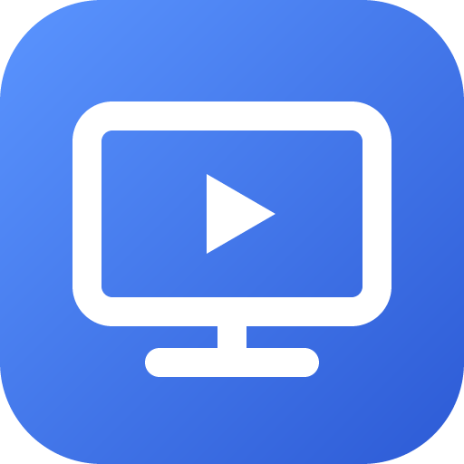

# LocalStreamShare

[下载 Windows 版](https://github.com/hungbok/localstreamshare-releases/releases/latest) · [English](README.md) · [한국어](README.ko.md) · [日本語](README.ja.md) · [繁體中文](README.zh-TW.md)

以超低延迟将**您选择的画面和声音**串流到同一 Wi‑Fi/局域网内的手机、电脑和电视。观看端只需用浏览器打开地址。开发者：**HungBok**

## 主要功能

- **在您自己的网络内运行。** 视频从电脑直接发送到观看设备 (WebRTC)。无需账号，不经过外部服务器，没有时间限制。
- **画面来源**：显示器、单个窗口、采集卡/摄像头 (不经过电脑屏幕直接串流)、视频文件、手机或其他电脑的屏幕
- **音频来源**：输出设备、仅特定应用 (或排除特定应用)、麦克风、采集卡声音。可分别设置音量并混合。
- 面向游戏的**超低延迟预设**：硬件 H.264 · 60fps · 1080p，观看端缓冲最小化
- **GPU 画质增强**：超分辨率 (NVIDIA DLSS / DLAA、NVIDIA RTX™ Video、AMD FSR™、Intel® XeSS、Anime4K)、帧生成 (NVIDIA VFG、DLSS Frame Generation、FSR 3、运动插帧)、抗锯齿、降噪、色彩校正。所需文件均已包含。
- **以手机作为来源**：Android 通过无线调试获取画面、声音并可操控 (无需安装应用)；iPhone、iPad 可用 AirPlay 屏幕镜像；任何设备都可用浏览器；也可用 RTMP 直播应用
- **会记住**窗口位置、所选来源和音量、地址和端口。所选窗口、设备或应用消失后，重新出现时自动切换回来。
- **在后台继续运行**: 最小化的窗口也可选择并串流，正在串流的窗口最小化后也不会停止。
- 需要时可**从互联网访问** (默认关闭): 自动在路由器上开放端口，显示公网 IP、端口和二维码，并由 PIN 保护。
- 预览全屏 (含手机操作面板)、性能面板 (F3)、访问 PIN、连接用二维码
- 支持韩语、英语、日语、简体中文和繁体中文。观看页面按打开设备的语言显示。

## 安装

1. 从 [Releases](https://github.com/hungbok/localstreamshare-releases/releases/latest) 下载 `LocalStreamShare-Setup-x.y.z.exe` 并运行。
2. 选择语言并阅读许可协议，然后选择安装位置和快捷方式。程序为所有用户安装，会请求一次管理员权限。
3. 安装程序没有代码签名，Windows SmartScreen 可能会发出警告。请确认文件来自本页面，然后选择**更多信息 → 仍要运行**。
   - 如果开启了**智能应用控制** (部分新的 Windows 11 电脑)，Windows 会直接阻止所有未签名的程序。可在 **Windows 安全中心 → 应用和浏览器控制** 中查看状态。
4. 首次启动时 Windows 防火墙会询问是否允许。**请在专用网络上允许**，否则其他设备无法连接。

需要 **Windows 10 2004 或更高版本 / Windows 11，64 位**。无需安装其他软件。需要约 1GB 磁盘空间。

## 快速开始

1. 在**画面来源**中选择画面，在**音频来源**中打开要发送的声音。
2. 点击**开始串流**。
3. 在其他设备上打开**访问地址**中显示的地址 (例如 `http://192.168.0.10:47800`)，或扫描二维码。

如果同一网络还有其他人使用，请设置**访问 PIN**。

### 从其他网络观看

打开 **设置 → 允许外部 (互联网) 访问** 后，会在路由器上开放端口 (UPnP)，并显示用于连接的公网 IP 和端口；若路由器不支持，则列出需要自行转发的端口。外部设备需要**外部访问 PIN**，且只能观看。没有公网 IP 的线路可能无法使用。不使用时请关闭。

## 以手机或其他电脑作为来源

步骤显示在**画面来源 → 外部设备 → 连接设备**中。

| 设备 | 方式 | 操控 |
|---|---|---|
| Android 11 及以上 | 无线调试 (扫码配对)，画面和声音 | 触摸、键盘、剪贴板 |
| Android 5~10 | USB 调试线 | 同上 |
| iPhone · iPad · Mac | AirPlay 屏幕镜像 (实验性) 或 RTMP 直播应用 (例如 Larix Screencaster) | 蓝牙鼠标/键盘 (实验性) |
| PC · Mac · Chromebook | 通过网页共享屏幕 | – |
| 手机摄像头 | 网页 | – |

Android 连接文件 ([scrcpy](https://github.com/Genymobile/scrcpy) 服务端和 adb) 已包含。接收 AirPlay 使用 [UxPlay](https://github.com/FDH2/UxPlay) 的非官方实现，并非由 Apple 提供。Netflix 等受保护的视频不会被镜像。

## GPU 功能

| 功能 | 要求 |
|---|---|
| NVIDIA DLSS / DLAA、RTX Video 超分辨率、Video Frame Generation | NVIDIA RTX GPU 和最新驱动 |
| NVIDIA DLSS Frame Generation | NVIDIA RTX 40 系列或更新 |
| AMD FSR 2 / 3、FSR 3 Frame Generation、Intel XeSS | 所有较新的 GPU (NVIDIA、AMD、Intel，DirectX 12) |
| AMD FSR 4 | AMD Radeon RX 9000 系列 |
| FSR 1.0、Anime4K、运动插帧、抗锯齿、降噪 | 所有 GPU |

此电脑无法使用的项目会显示为不可用。

## 更新

程序会在启动时和每四小时检查新版本，并在后台下载。不会中断串流，可随时重新启动，或在退出程序时安装。可在**设置**中关闭。

## 隐私

画面和声音只会发送到同一网络中连接的设备。程序自身只会为了在 GitHub 检查更新而连接互联网；只有在允许外部访问时，才会连接查询公网 IP 的服务 (如 ipify) 并接受来自互联网的连接。所选来源等记住的内容只保存在此电脑上。NVIDIA 组件可能通过 NVIDIA 驱动程序更新。

## 无法连接时

- 两台设备必须连接同一路由器。访客 Wi‑Fi 通常会阻止设备之间互相访问。
- 在 **Windows 安全中心 → 防火墙和网络保护 → 允许应用通过防火墙** 中，确认当前网络类型 (专用或公用) 已允许 LocalStreamShare。
- 使用 5GHz Wi‑Fi 或有线连接可获得更低延迟。

## 许可证

LocalStreamShare 依据 MIT 许可证免费提供。随附的组件适用各自的许可证，位于安装目录的 `licenses` 文件夹 (**设置 → 打开许可证文件夹**)。

| 组件 | 许可证 |
|---|---|
| NVIDIA DLSS、NVIDIA RTX™ Video、NVIDIA Video Effects、CUDA 运行库 | NVIDIA RTX SDKs License、NVIDIA Software License Agreement、NVIDIA Open Model License |
| AMD FidelityFX | AMD 许可证 / MIT |
| Intel XeSS | Intel Simplified Software License |
| scrcpy 服务端、Android Debug Bridge | Apache License 2.0 |
| FairPlay.exe (UxPlay) | GPL‑3.0，源代码位于 `licenses\FairPlay\source` |
| Microsoft Visual C++ 运行库 | Microsoft 许可证 |
| Electron、Anime4K 等 | `THIRD_PARTY_NOTICES.txt` |

NVIDIA 组件只能在装有 NVIDIA GPU 的电脑上使用，不得单独再分发。本程序并非由 NVIDIA、AMD、Intel、Microsoft、Apple 或 Google 认可或赞助，商标归各公司所有。
