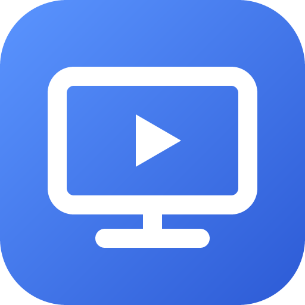

# LocalStreamShare

[下載 Windows 版](https://github.com/hungbok/localstreamshare-releases/releases/latest) · [English](README.md) · [한국어](README.ko.md) · [日本語](README.ja.md) · [简体中文](README.zh-CN.md)

以超低延遲將**您選擇的畫面與聲音**串流到同一 Wi‑Fi/區域網路內的手機、電腦與電視。觀看端只需用瀏覽器開啟網址。開發者：**HungBok**

## 主要功能

- **在您自己的網路內運作。** 影像從電腦直接傳送到觀看裝置 (WebRTC)。不需帳號，不經過外部伺服器，沒有時間限制。
- **畫面來源**：螢幕、單一視窗、擷取卡/攝影機 (不經過電腦螢幕直接串流)、影片檔案、手機或其他電腦的螢幕
- **音訊來源**：輸出裝置、僅特定程式 (或排除特定程式)、麥克風、擷取卡聲音。可分別設定音量並混合。
- 適合遊戲的**超低延遲預設**：硬體 H.264 · 60fps · 1080p，觀看端緩衝最小化
- **GPU 畫質增強**：超解析度 (NVIDIA DLSS / DLAA、NVIDIA RTX™ Video、AMD FSR™、Intel® XeSS、Anime4K)、畫格生成 (NVIDIA VFG、DLSS Frame Generation、FSR 3、動態補間)、反鋸齒、降噪、色彩校正。所需檔案均已包含。
- **以手機作為來源**：Android 透過無線偵錯取得畫面、聲音並可操控 (不需安裝應用程式)；iPhone、iPad 可用 AirPlay 螢幕鏡像；任何裝置都可用瀏覽器；也可用 RTMP 直播應用程式
- **會記住**視窗位置、所選來源與音量、位址與連接埠。所選視窗、裝置或應用程式消失後，再次出現時自動切換回來。
- **在背景繼續執行**: 最小化的視窗也可選擇並串流，正在串流的視窗最小化後也不會停止。
- 需要時可**從網際網路存取** (預設關閉): 自動在路由器上開放連接埠，顯示公用 IP、連接埠與 QR 碼，並由 PIN 保護。
- 預覽全螢幕 (含手機操作面板)、效能面板 (F3)、存取 PIN、連線用 QR 碼
- 支援韓文、英文、日文、簡體中文與繁體中文。觀看頁面依開啟裝置的語言顯示。

## 安裝

1. 從 [Releases](https://github.com/hungbok/localstreamshare-releases/releases/latest) 下載 `LocalStreamShare-Setup-x.y.z.exe` 並執行。
2. 選擇語言並閱讀授權合約，然後選擇安裝位置與捷徑。程式會為所有使用者安裝，並要求一次系統管理員權限。
3. 安裝程式沒有程式碼簽章，Windows SmartScreen 可能會發出警告。請確認檔案來自本頁面，然後選擇**其他資訊 → 仍要執行**。
   - 如果開啟了**智慧型應用程式控制** (部分新的 Windows 11 電腦)，Windows 會直接封鎖所有未簽章的程式。可在 **Windows 安全性 → 應用程式與瀏覽器控制** 中查看狀態。
4. 首次啟動時 Windows 防火牆會詢問是否允許。**請在私人網路上允許**，否則其他裝置無法連線。

需要 **Windows 10 2004 以上版本 / Windows 11，64 位元**。不需安裝其他軟體。需要約 1GB 磁碟空間。

## 快速開始

1. 在**畫面來源**中選擇畫面，在**音訊來源**中開啟要傳送的聲音。
2. 按下**開始串流**。
3. 在其他裝置上開啟**連線位址**中顯示的網址 (例如 `http://192.168.0.10:47800`)，或掃描 QR 碼。

如果同一網路還有其他人使用，請設定**存取 PIN**。

### 從其他網路觀看

開啟 **設定 → 允許外部 (網際網路) 存取** 後，會在路由器上開放連接埠 (UPnP)，並顯示用於連線的公用 IP 與連接埠；若路由器不支援，則列出需要自行轉送的連接埠。外部裝置需要**外部存取 PIN**，且只能觀看。沒有公用 IP 的線路可能無法使用。不使用時請關閉。

## 以手機或其他電腦作為來源

步驟顯示在**畫面來源 → 外部裝置 → 連接裝置**中。

| 裝置 | 方式 | 操控 |
|---|---|---|
| Android 11 以上 | 無線偵錯 (掃碼配對)，畫面與聲音 | 觸控、鍵盤、剪貼簿 |
| Android 5~10 | USB 偵錯傳輸線 | 同上 |
| iPhone · iPad · Mac | AirPlay 螢幕鏡像 (實驗性) 或 RTMP 直播應用程式 (例如 Larix Screencaster) | 藍牙滑鼠/鍵盤 (實驗性) |
| PC · Mac · Chromebook | 透過網頁分享螢幕 | – |
| 手機相機 | 網頁 | – |

Android 連線檔案 ([scrcpy](https://github.com/Genymobile/scrcpy) 伺服器與 adb) 已包含。接收 AirPlay 使用 [UxPlay](https://github.com/FDH2/UxPlay) 的非官方實作，並非由 Apple 提供。Netflix 等受保護的影片不會被鏡像。

## GPU 功能

| 功能 | 需求 |
|---|---|
| NVIDIA DLSS / DLAA、RTX Video 超解析度、Video Frame Generation | NVIDIA RTX GPU 與最新驅動程式 |
| NVIDIA DLSS Frame Generation | NVIDIA RTX 40 系列以上 |
| AMD FSR 2 / 3、FSR 3 Frame Generation、Intel XeSS | 所有較新的 GPU (NVIDIA、AMD、Intel，DirectX 12) |
| AMD FSR 4 | AMD Radeon RX 9000 系列 |
| FSR 1.0、Anime4K、動態補間、反鋸齒、降噪 | 所有 GPU |

此電腦無法使用的項目會顯示為無法使用。

## 更新

程式會在啟動時與每四小時檢查新版本，並在背景下載。不會中斷串流，可隨時重新啟動，或在結束程式時安裝。可在**設定**中關閉。

## 隱私

畫面與聲音只會傳送到同一網路中連線的裝置。程式本身只會為了在 GitHub 檢查更新而連線網際網路；只有在允許外部存取時，才會連線至查詢公用 IP 的服務 (如 ipify) 並接受來自網際網路的連線。所選來源等記住的內容只儲存在此電腦上。NVIDIA 元件可能透過 NVIDIA 驅動程式更新。

## 無法連線時

- 兩台裝置必須連接同一個路由器。訪客 Wi‑Fi 通常會阻止裝置之間互相存取。
- 在 **Windows 安全性 → 防火牆與網路保護 → 允許應用程式通過防火牆** 中，確認目前的網路類型 (私人或公用) 已允許 LocalStreamShare。
- 使用 5GHz Wi‑Fi 或有線連線可獲得更低延遲。

## 授權

LocalStreamShare 依據 MIT 授權條款免費提供。隨附的元件適用各自的授權條款，位於安裝目錄的 `licenses` 資料夾 (**設定 → 開啟授權資料夾**)。

| 元件 | 授權 |
|---|---|
| NVIDIA DLSS、NVIDIA RTX™ Video、NVIDIA Video Effects、CUDA 執行階段 | NVIDIA RTX SDKs License、NVIDIA Software License Agreement、NVIDIA Open Model License |
| AMD FidelityFX | AMD 授權條款 / MIT |
| Intel XeSS | Intel Simplified Software License |
| scrcpy 伺服器、Android Debug Bridge | Apache License 2.0 |
| FairPlay.exe (UxPlay) | GPL‑3.0，原始碼位於 `licenses\FairPlay\source` |
| Microsoft Visual C++ 執行階段 | Microsoft 授權條款 |
| Electron、Anime4K 等 | `THIRD_PARTY_NOTICES.txt` |

NVIDIA 元件只能在裝有 NVIDIA GPU 的電腦上使用，不得單獨再散布。本程式並非由 NVIDIA、AMD、Intel、Microsoft、Apple 或 Google 認可或贊助，商標歸各公司所有。
